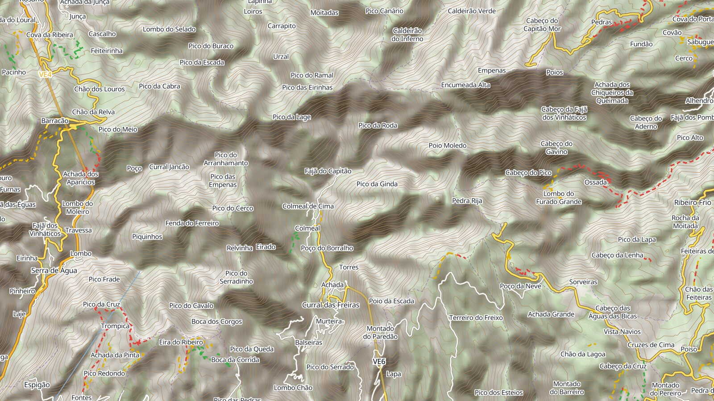
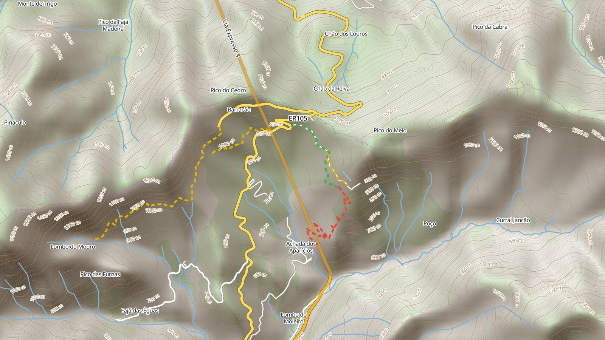
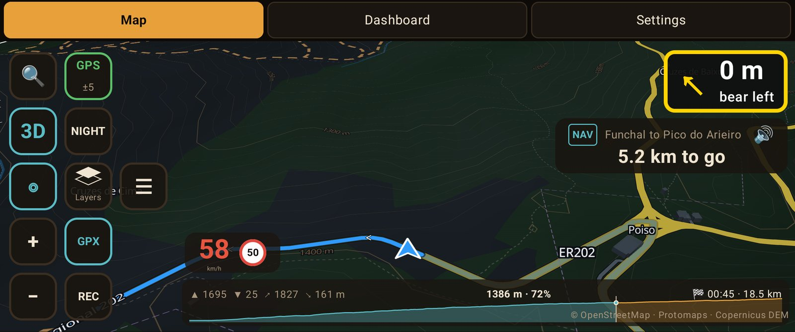
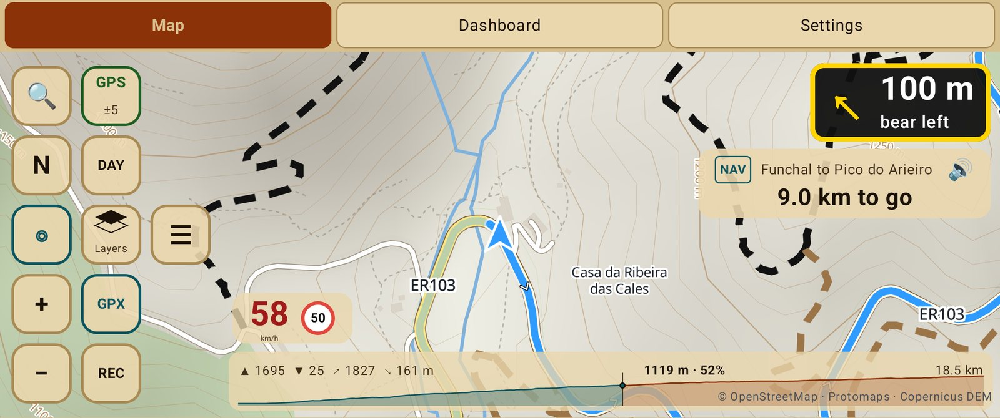
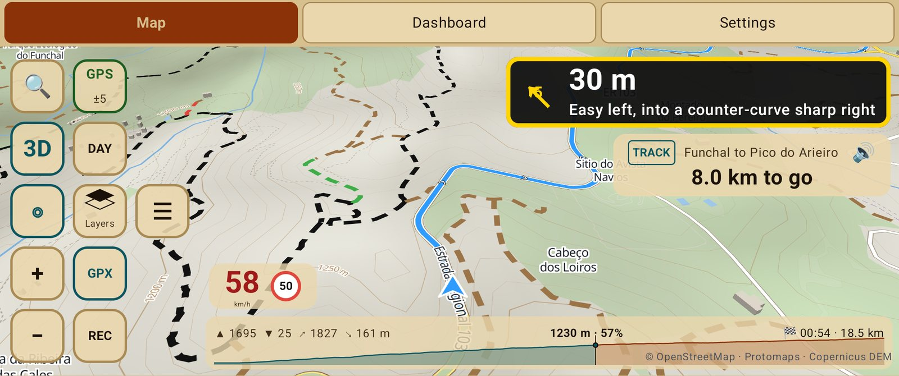
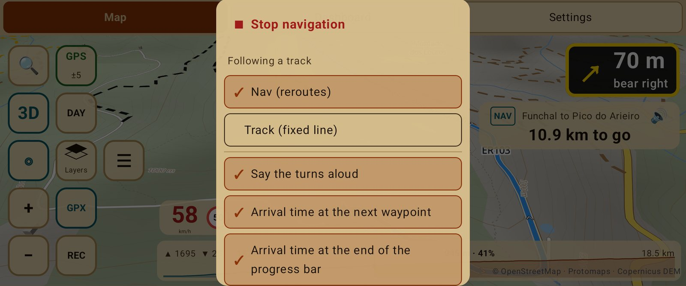
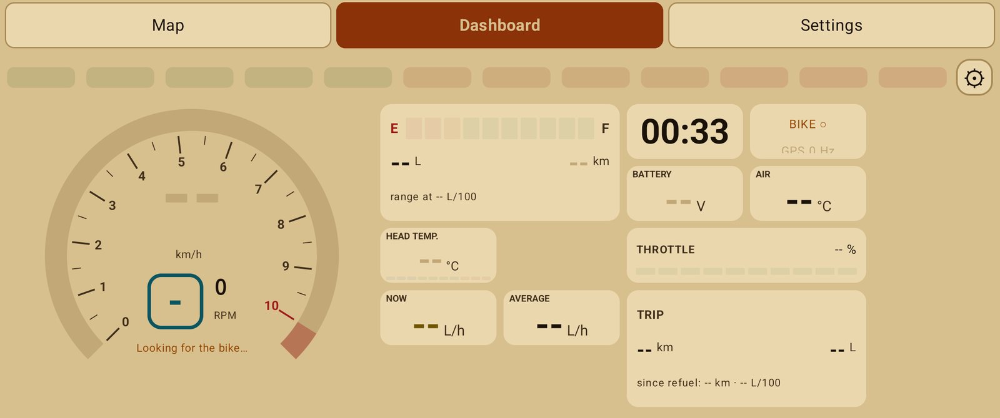
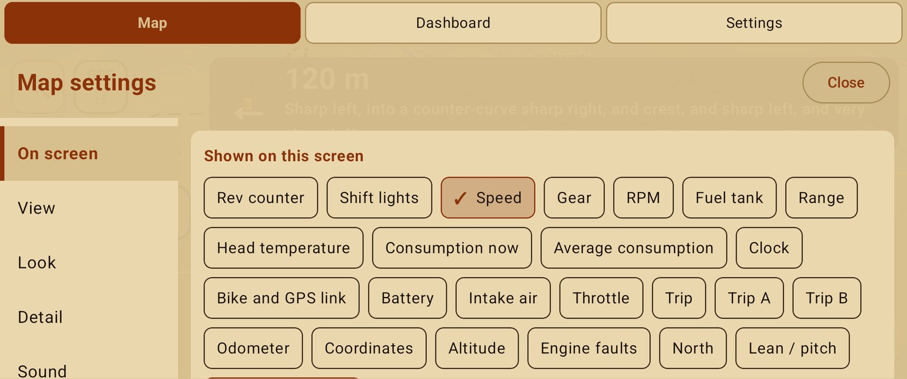

# NavExpress

**A motorcycle navigator that rides like a co-driver.**

Offline maps for anywhere · turn by turn and rally pacenotes · rain along your route ·
a smart dashboard for your bike

[**Download**](../../releases/latest) · [Getting started](docs/getting-started.md) ·
[How-to guides](docs/how-to/README.md) · [User guide](docs/app-guide.md) ·
[Roadmap](ROADMAP.md) · [Changelog](CHANGELOG.md)

## Why NavExpress

- **It works where you ride.** Maps, speed limits, contours and even routing live on the
  phone, so the screen keeps going in the mountains with no signal.
- **It reads the road for you.** Turn by turn with the road names for touring, and
  rally-style pacenotes from the track's own shape when you ride a line.
- **It is built for the handlebar.** Big glove-sized controls, a screen you lay out yourself,
  themes that follow the sun, and a bike unit that adds the engine to the picture.

Free, with no account, no ads and no tracking.

## Features

### 🗺️ Maps that work anywhere

 

- Download any country or region over Wi-Fi; the phone cuts it straight from the world map.
  Rebuilt every month from fresh OpenStreetMap data.
- Contour lines, shaded relief and 3D buildings; road colours by class and names in your
  language.
- Speed limit sign and speed camera warnings; dirt roads coloured by difficulty.
- Choose from how close each kind of detail shows, and long press any layer for its options.

### 🧭 Navigation built for riders

 

- Search an address or a place, or long press the map, and **Go there**.
- **Offline routing** with three route types: **Fastest**, **Economical** and **Fun** (seeks
  dirt within the detour you allow), each with its own avoids.
- Turn by turn on screen and by voice, with the road you take ("Turn left onto N4").
- Rerouting from where you are, arrival times worked out from your own pace, a height profile
  of the road ahead with the total climb.
- **Rain along your route** at the time you will get there, drawn on the progress bar.

### 🏁 Ride a track like a rally

 

- Import GPX, KML, KMZ, GeoJSON, TCX or FIT, or plan your own with numbered waypoints.
- **Nav** mode reroutes back to the line; **Track** mode keeps the line exact and guides you
  back to it.
- **Pacenotes** read from the track itself: corners graded 1 to 6, hairpins, tightens, opens,
  crests and dips, linked calls and the distance to the next one.
- **Section times**: Fast or Slow against your best on every stretch you ride again.

### 📱 Your screen, your way

 

- The Map and the Dashboard are built from elements you pick, place and size: speed, gear,
  RPM, fuel, range, trips, clock, altitude, north, lean and more.
- Themes for day and night that switch at sunset, interface from 85 % to 150 %, units for
  any country, six languages.
- Calls and messages with glove-sized buttons, kept away from the navigation boxes.
- Ride recording, favourite places, distance measuring, direct lines.
- Backup to one file, in-app updates, and suggestions or crash reports straight from the app.

### 🏍️ With the bike unit

The optional **NavExpress Brain** is an ESP32-S3 on the bike's CAN bus. With it the phone
also shows RPM and shift lights, gear, head temperature with a STOP ENGINE warning, fuel
flow, tank and range, and reads and clears the engine's fault codes.
[More about the bike unit](docs/brain.md).

## Get started

1. **Install**: download the newest APK from the [latest release](../../releases/latest) on
   the phone and open it.
2. **Download your maps**: ☰ → Regions, search your country, Download.
3. **Ride**: 🔍 to go somewhere, or open a GPX with NavExpress and Follow.

The [Getting started guide](docs/getting-started.md) covers permissions, keeping the app
running with the screen off and connecting the bike unit, for any Android phone.

## Documentation

| | |
|---|---|
| [Getting started](docs/getting-started.md) | Install, permissions, background running, first ride |
| [How-to guides](docs/how-to/README.md) | Step by step: maps, routes, tracks, pacenotes, weather, screens, backup |
| [User guide](docs/app-guide.md) | Every screen and option, for reference |
| [Bike unit](docs/brain.md) | Hardware, firmware features, build, flash and tests |
| [Roadmap](ROADMAP.md) | What is being built now and what comes next |
| [Changelog](CHANGELOG.md) | What changed, version by version |

## Project status

NavExpress is under active development and is ridden on real roads with each step. The map,
navigation and track features are in daily use; the **Dashboard tab is still being worked
on** (rows you choose and a split screen with the map are next), so its layout may change
between versions. See the [roadmap](ROADMAP.md) for what is coming.

Ideas and problems are welcome: Settings → About → **Send a suggestion** in the app, or
[open an issue](../../issues/new).

## Credits

Created by Artur Pelicho, with Claude.

Map data © [OpenStreetMap](https://www.openstreetmap.org/copyright) contributors ·
base map [Protomaps](https://protomaps.com) · relief Copernicus DEM GLO-30 © DLR/Airbus,
provided under COPERNICUS by the European Union and ESA · routing
[BRouter](https://github.com/abrensch/brouter) · map engine
[MapLibre](https://maplibre.org) · search [Photon](https://photon.komoot.io) and
[Nominatim](https://nominatim.org) · weather [Open-Meteo](https://open-meteo.com) · rain
radar [RainViewer](https://www.rainviewer.com).
