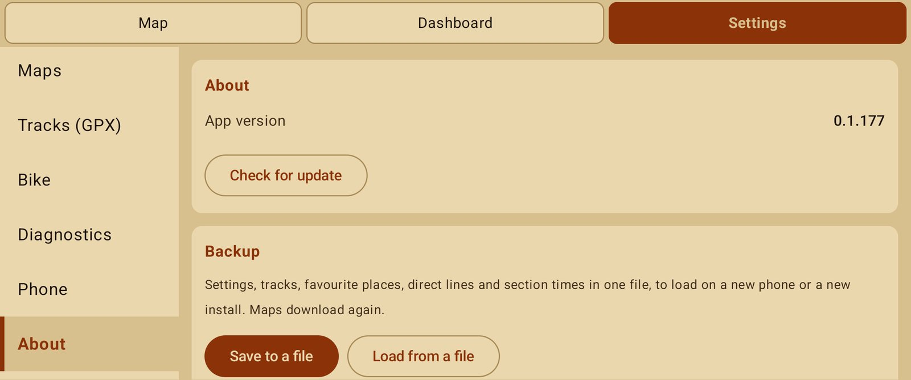

# Back up and move to a new phone

## Save

1. Settings → About → Backup → **Save to a file**.
2. Choose where to keep the file (Drive, Downloads, a memory card…).

The file holds every setting (themes, units, screens and layouts, map options, route options,
sounds) and your data: tracks, recorded rides, section bests, favourite places and direct lines.
Map files are not in it, so it stays small.

## Load

1. Install NavExpress on the new phone ([how](../getting-started.md#install-the-app)).
2. Settings → About → Backup → **Load from a file** and pick the file.
3. The app restarts with everything back. Download your maps again in ☰ → Regions.

Loading adds to what is already on the phone rather than wiping it. Backups are versioned, so a
newer app keeps reading files saved by an older one.
