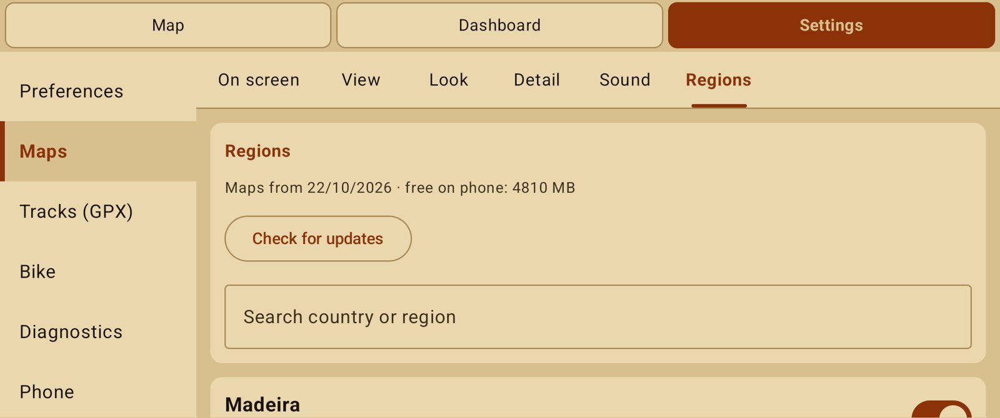

# Download maps for a trip

NavExpress keeps its maps on the phone, so the map, the speed limits and (with offline
routing) the route all work with no signal.

## Download a region

1. On the map tap **☰** and open **Regions** (also in Settings → Maps).
2. Type a country or region in **Search country or region**.
3. Tap **Download**. Use Wi-Fi: a country is several hundred MB. The size shown includes what
   comes with the map:
   - **contour lines** and **shaded relief** for the mountains;
   - **limits**: speed limits, speed cameras and dirt roads by difficulty.
4. The download carries on in the background; the region says **Installed** when it is ready.
   You can keep using the map in the meantime.

Riding across a border? Download both regions; the map joins them by itself.

## Routes without signal

Under each installed region, **Offline routes** downloads the routing data (about 125 MB per
region). With it, routes and rerouting work anywhere. Without it, NavExpress asks an online
routing server while there is a connection, and joins your waypoints in straight lines when
there is none.

## Keep maps up to date

Maps are rebuilt every month from fresh OpenStreetMap data, so new roads, limits and cameras
reach the app.

- **Check for updates** compares your maps with the newest build.
- **Update all** fetches every region that has a newer version.
- An older map missing the newer extras shows **Add speed limits and cameras** or **Add shaded
  relief**, which fetch only those.

## Save space

Switch a region off to hide it without deleting it, or delete it to free the space. The list
shows how much is free on the phone.

> Speed limits and cameras come from OpenStreetMap. The road signs always come first.
