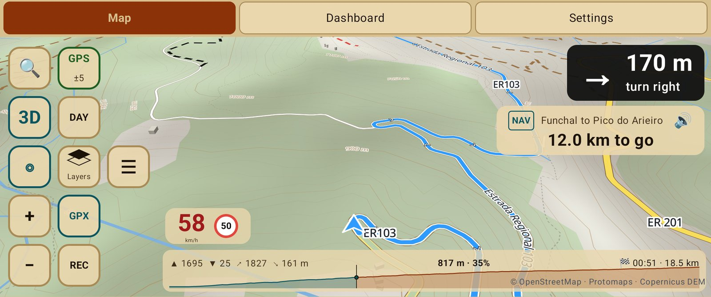

# Ride a GPX track

For a route a friend sent you, a rally road book or a track from a ride website.

## Import it

Any of these works:

- Open the file from your file manager, messaging app or browser and choose **NavExpress**.
- Settings → Tracks → Import → **Open file**.

GPX, KML, KMZ, GeoJSON, TCX and FIT are read. The track is kept in the app; you don't need
the file afterwards.

## Follow it

In Settings → Tracks → Routes, tap the track, then **Follow**. To ride it the other way,
**Reverse direction**.

On the map the track box shows how far is left and when you arrive, and the progress bar
underneath shows the height profile ahead, with the total climb and descent.

## Nav or Track mode

Long press the track box to choose how the app treats the line:

| Mode | When you leave the line | Best for |
|---|---|---|
| **Nav** (reroutes) | Works out a road route from where you are back to the next waypoint or the end. The original fades and the new route is drawn on top | Road trips, planned routes |
| **Track** (fixed line) | The line stays the line; a thin dashed guide leads to its nearest point, with a warning | Rally tracks, off-road, exact lines |

Track mode also gives you [pacenotes and section times](pacenotes.md).

## Hide the line

Tap **GPX** on the button bar to hide or show the followed track. Navigation carries on;
long press **GPX** for the list of tracks.
