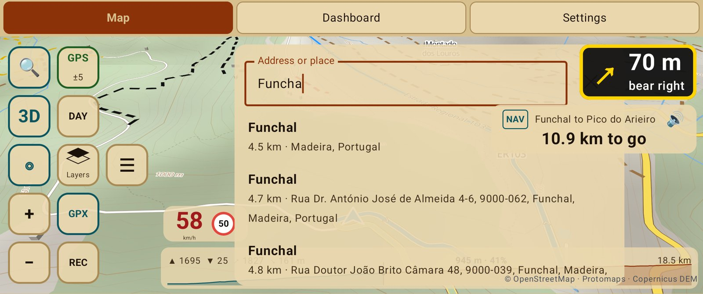

# Go somewhere

## Search an address or a place

1. Tap **🔍** on the button bar.
2. Type an address, a town, a viewpoint or a business. Your favourite places come first,
   then results from OpenStreetMap (search needs a connection).
3. Tap a result. It shows pinned on the map with two choices:
   - **Go there**: a route from where you are, right away.
   - **Save as favourite**: keep it for later.

## Pick a point on the map

Long press anywhere on the map and choose **Go there**.

## Favourite places

Long press the map → **Save as favourite** (home, work, the café at the top of the pass).
They are listed in Settings → Tracks → Places, each with **Go there**.

## While you ride

- The **turn banner** shows the next turn and the road you take ("Turn left onto N4"), and
  the voice reads it out in good time. Sound volumes are in Map settings → Sound.
- The **track box** shows the distance to go and your arrival time, worked out from how you
  actually ride.
- Take a different road and the route is worked out again from where you are.
- To stop, **long press the track box → Stop navigation**.

Next: [choose the kind of route](route-types.md).
