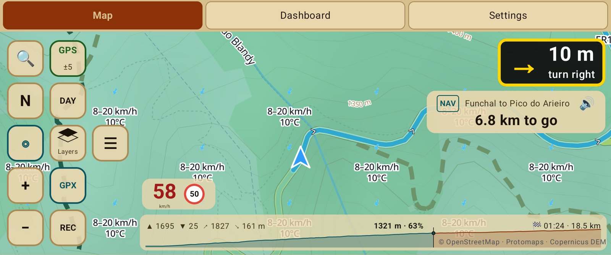

# See the weather ahead

Weather needs a connection now and then; the last forecast is kept for stretches with no
signal. It is off until you switch it on.

## Rain along your route

While you follow a route, a blue lane along the top of the progress bar shows the rain forecast
**for the time you reach each place**: deeper blue for heavier rain. An outline marks rain that
is falling now but should have stopped by the time you get there. The first rain ahead is
named with its distance and time, for example "🌧 42 km · 14:40".

Long press the progress bar for the legend. Switch the lane with **Rain ahead on the progress
bar** in the track box menu.

## Weather on the map

Tap the layers button and switch on **Weather**. The map is tinted by **temperature**, from
blue (cold) through green to red (hot), with **wind arrows** across the whole screen: each
points where the wind blows to, larger and redder the stronger it is. Values are written on
some of the arrows, spread evenly.

Long press **Weather** to choose what it shows:

- **Wind**: the arrows, with gusts in the values. With temperature off, the tint shows wind
  strength instead.
- **Temperature**: the tint and the values.
- **Rain**: the radar now, and the forecast in the values.
- **UV**.

Move or zoom the map and the weather follows a moment after it stops. Places you have already
looked at keep their weather on the phone for a day and a half, for when there is no signal.

Forecast: Open-Meteo. Rain radar: RainViewer.
